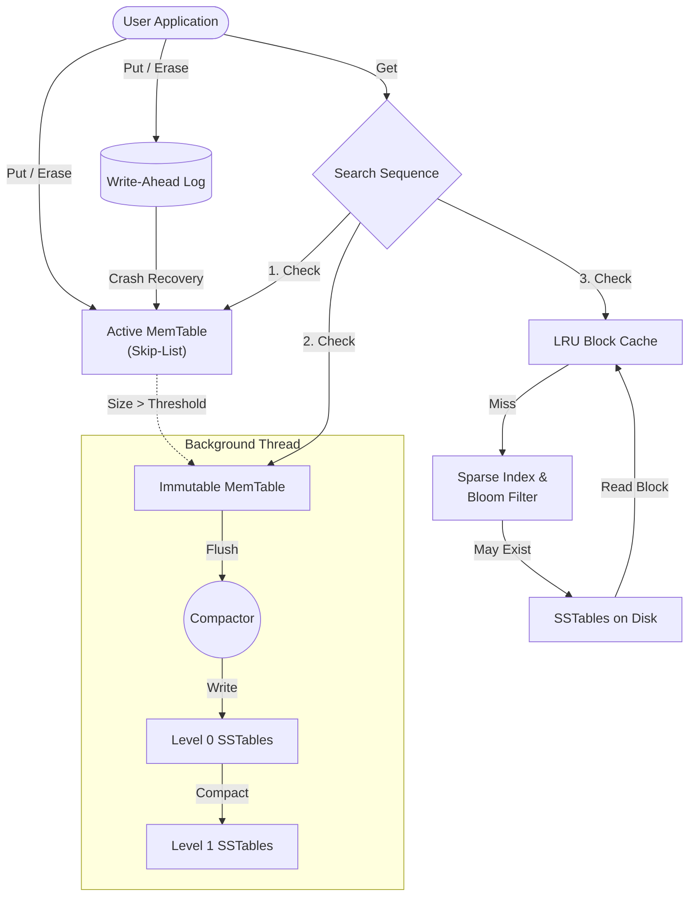

# Mini-LevelDB

A miniature, high-performance Log-Structured Merge (LSM) Tree key-value engine built from scratch in modern C++20. 

## Table of Contents
1. [What is an LSM Tree Key-Value Engine?](#what-is-an-lsm-tree-key-value-engine)
2. [Why is it Needed?](#why-is-it-needed)
3. [Core Functionality](#core-functionality)
4. [How It Was Made](#how-it-was-made)
5. [Project Features](#project-features)
6. [Unique Features](#unique-features)
7. [Use Cases](#use-cases)
8. [Project Architecture](#project-architecture)

---

## What is an LSM Tree Key-Value Engine?

An **LSM Tree (Log-Structured Merge-Tree)** is a data structure optimized for write-heavy workloads. Unlike traditional B-Trees, which update data in-place and can cause heavy disk seeks, an LSM tree treats all writes as sequential appends. 
When you write a key-value pair, it is first logged to a Write-Ahead Log (WAL) and stored in an in-memory structure called a **MemTable**. Once the MemTable reaches a certain size, it is flushed to disk as an immutable **SSTable** (Sorted String Table). Over time, background processes merge and compact these SSTables to reclaim space and maintain read performance.

## Why is it Needed?

Modern storage devices, including SSDs and HDDs, perform sequential writes orders of magnitude faster than random writes. 
- Traditional databases (using B-Trees) often suffer from **write amplification** and high latency during random write bursts.
- LSM Trees absorb write spikes by keeping recent data in memory and serializing disk I/O, making them the standard for high-throughput modern databases like Cassandra, RocksDB, and LevelDB.

## Core Functionality

- **Get / Put / Erase:** Standard Key-Value API.
- **Crash Recovery:** Every operation is safely appended to a WAL. If the system crashes, un-flushed data is recovered upon restart.
- **Background Compaction:** Old data and tombstones (deleted records) are cleared asynchronously without blocking active reads/writes.
- **Optimized Reads:** Employs bloom filters, sparse indexing, and an LRU Block Cache to guarantee O(1) or O(log N) lookups despite the data being spread across multiple files.

## How It Was Made

This project was built from scratch using **C++20**. It leverages:
- `std::pmr` (Polymorphic Memory Resources) for arena allocation in the Skip-List memtable, maximizing cache locality and avoiding memory fragmentation.
- Concurrency primitives (`std::shared_mutex`, `std::atomic`, `std::condition_variable`) to orchestrate non-blocking background compaction.
- Raw file I/O operations strictly conforming to binary serialization rules (avoiding padded structs) to keep SSTable reads fast and memory-safe.

## Project Features

- **Write-Ahead Log (WAL)**: Ensures strict durability by logging all mutations before memory insertion.
- **Skip-List Memtable**: Fast, lock-free lookups for the active memory component.
- **Immutable SSTables**: Zero-copy parsed records on disk, accompanied by a sparse block index.
- **Bloom Filters**: Bypasses expensive disk reads if a key definitely doesn't exist in a given SSTable.
- **LRU Block Cache**: Caches hot blocks in memory (default ~4MB) mapping 3D coordinates (SST ID, offset) to memory allocations.
- **CI & Crash Testing**: Thorough suite of engine tests, including `kill -9` process crash simulation and WAL truncation recovery. 

## Unique Features

- **Direct Block Fetching Mechanism**: Rather than reading character by character, it relies on a brutal block-extraction paradigm, instantly caching exact bounds for the LRU.
- **Polymorphic Memory Arena (PMR)**: Employs a custom `std::pmr::monotonic_buffer_resource` that speeds up node allocation in the MemTable. When the memtable is dropped, all nodes are implicitly destroyed with zero overhead.

- **Compaction Showdown (Leveled vs. Size-Tiered)**: The engine allows hot-swapping between Leveled Compaction and Size-Tiered Compaction behind a unified `CompactionStrategy` interface. This allows developers to directly benchmark and trade off write amplification against read latency using the provided benchmark suite.

## Use Cases

- **Time-Series Data:** Excellent for IoT and metrics logging where the write throughput is enormous.
- **Embedded Storage:** Can be dropped directly into an application as a local storage backbone.
- **Write-Heavy Caches:** Storing web logs, event sourcing, or analytics data where historical data is compacted later.

## Project Architecture

### Flow Summary:
1. **Write Path**: Operations append to the WAL. Data is inserted into the Active Memtable. When full, it becomes Immutable, and the background thread flushes it to a Level 0 SSTable. Compactions merge files downwards.
2. **Read Path**: The engine searches the Active MemTable -> Immutable MemTable -> LRU Cache. If it misses, it checks the Bloom Filter and Sparse Index for the relevant SSTable before hitting the disk.
